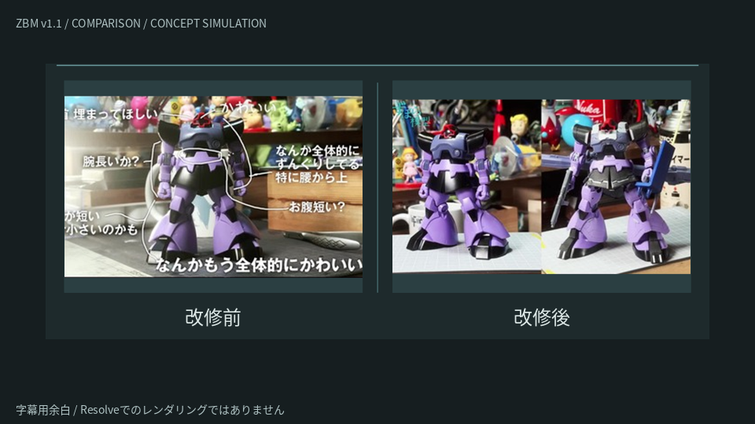

# ZBM UI SYSTEM v1.1 一括テスト用

v1.0のデザインを基準に、COMPARISON・REFERENCE・DETAILの3種類を再構成したパッケージです。

**[Windows用ZIPをダウンロード](https://github.com/lojamegero-bit/aaa/blob/main/downloads/ZBM_UI_SYSTEM_v1.1_test.zip?raw=true)**

ダウンロードが始まらない場合は、[ZIPのファイルページ](https://github.com/lojamegero-bit/aaa/blob/main/downloads/ZBM_UI_SYSTEM_v1.1_test.zip) を開き、右上の「Download raw file」（下向き矢印）を押してください。非公開リポジトリの場合はアクセス権のあるGitHubアカウントでログインが必要です。

1. ダウンロードしたZIPをWindowsで右クリックして「すべて展開」。
2. 中の `README.md` に従って導入します。
3. 3種類を同梱の実機テスト表でまとめて確認します。

**Resolve実機未検証です。** ファイル生成・Lua構文・参照・数値式・PNG／動画・ZIPの静的検査を実施。Windows実行、Editページでの画像交換、尺追従、4K再生性能・書き出しは未確認です。プレビューはResolve出力ではありません。詳細は [導入と操作](package/README.md)、[技術設計と制限](package/Docs/設計と制限.md)、[実機テスト](package/Docs/実機テスト.md) を参照してください。



サンプル画像は支給v1.0の概念プレビューから切り出した低解像度画像です。本番や画質検査には自分の原画像へ交換します。

`package/` に展開済み一式、`downloads/` に納品ZIPとSHA-256、`tools/` に再生成用スクリプトを保存しています。再生成にはPython 3、Pillow、FFmpeg、texluaと元のv1.0 ZIPが必要です。

```bash
python tools/build_package.py /path/to/v1.0.zip
python tools/package_and_validate.py
```

生成スクリプトのフォントパスはLinuxのNoto Sans CJKを想定しています。Windows用の導入にはPython等は不要です。
